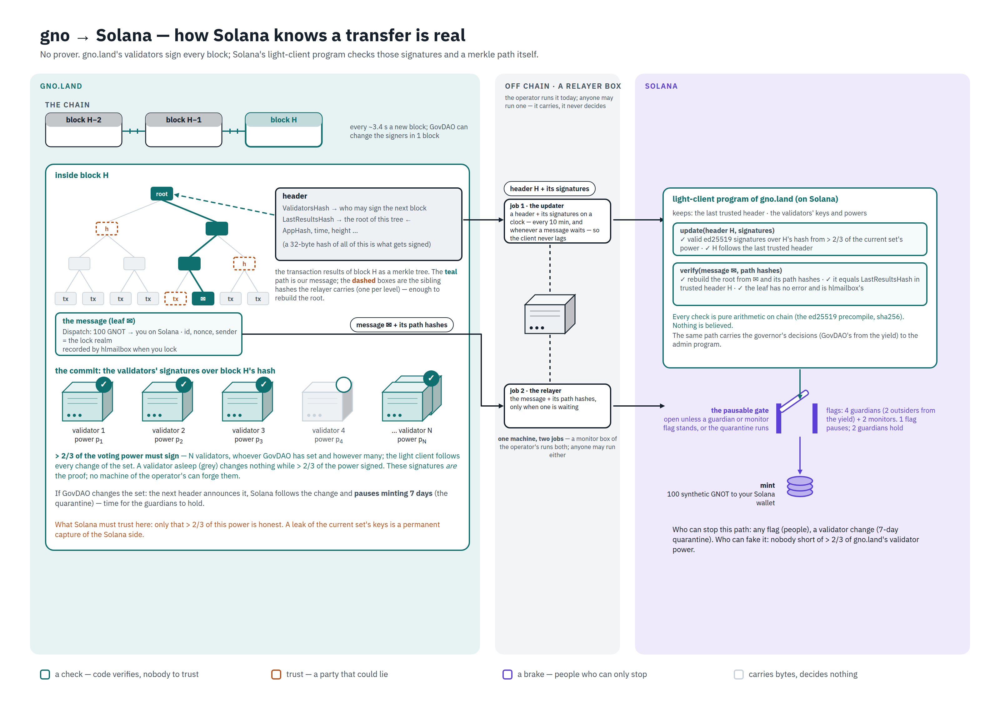
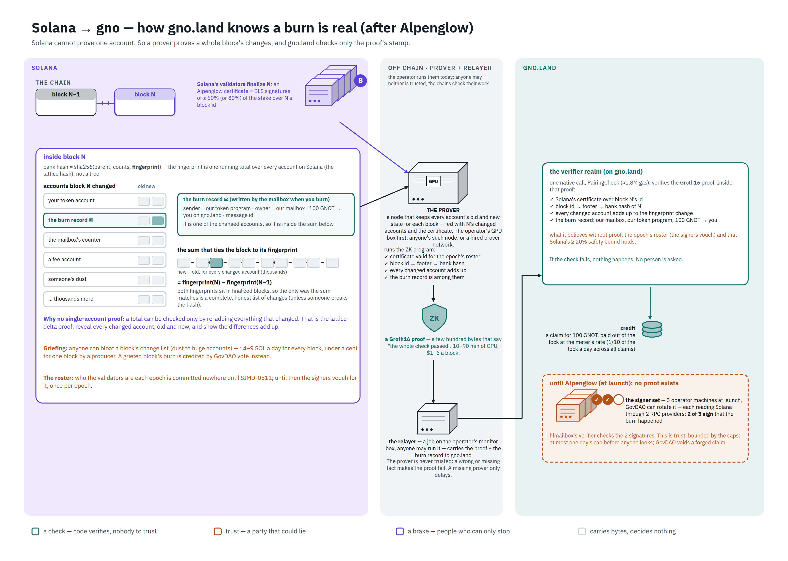
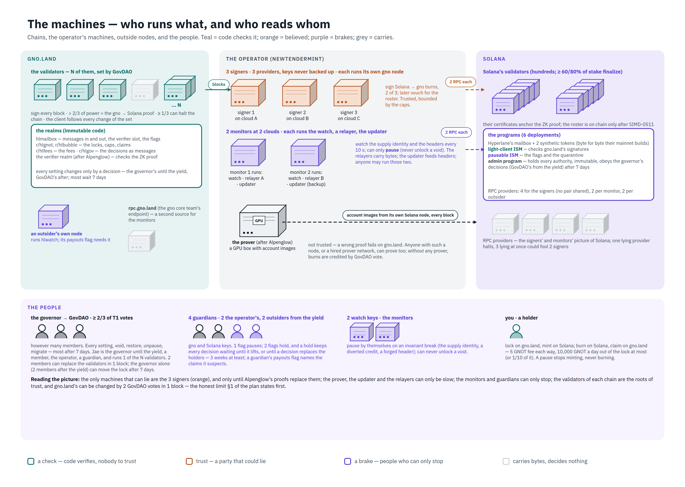
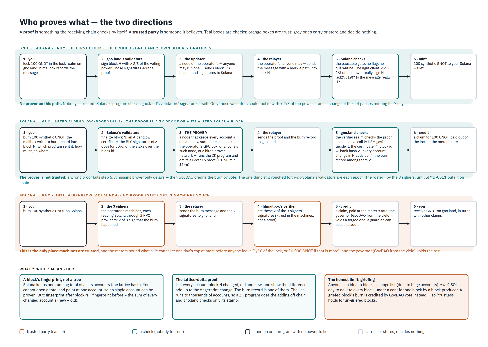
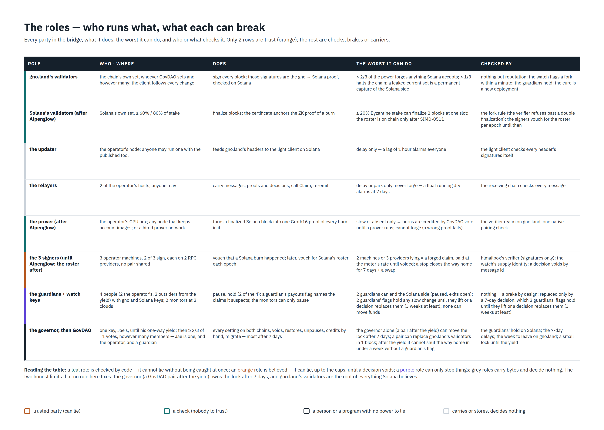
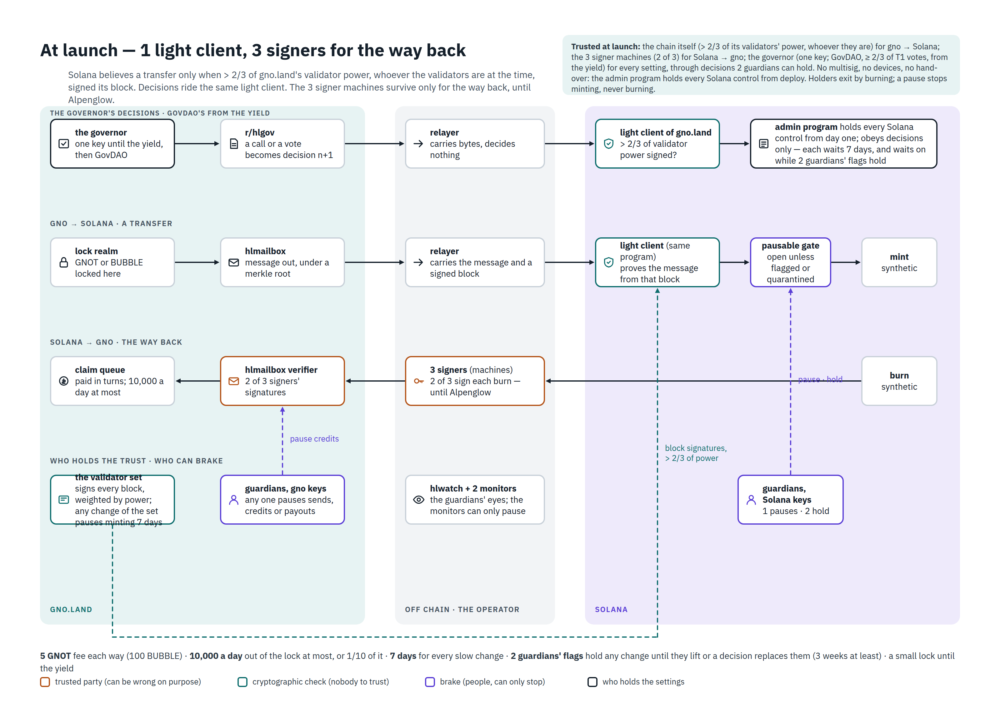
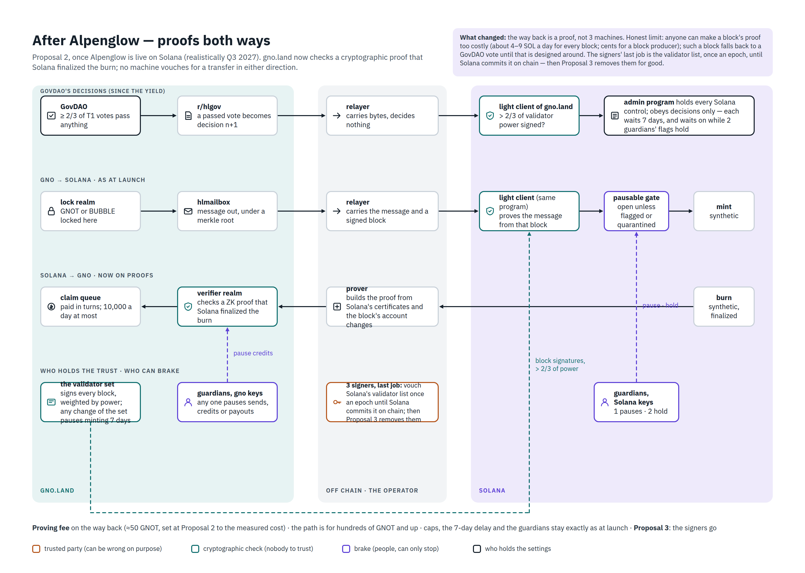

# bridges

gno.land's bridges to other chains. There is one today, in [`solana/`](solana/): it moves GNOT and BUBBLE between
gno.land and Solana.

The site is **[bridge.gno.world](https://bridge.gno.world)**. It sends, claims, and shows the bridge's state live.

## The Solana bridge

**gno.land to Solana is checked by Solana itself.** A light-client program on Solana accepts a transfer only when
more than 2/3 of gno.land's validator power signed the block that holds it, whoever the validators are at the time.
It also checks a merkle path from the transfer to that block. No machine of the operator's can forge this direction.

**Solana to gno.land is vouched for by three signer machines until Alpenglow.** Two of the three must sign each burn.
Once Solana's Alpenglow upgrade makes its finality provable, a zero-knowledge proof replaces them.

**Limits bound what a fault can take.** At most 10,000 tokens a day leave each lock, or 1/10 of the lock when that
is more. A change that loosens a limit or swaps a key waits 7 days. Four guardians can pause; two of them together
can hold any change. A pause stops minting, never burning.

**Status: live on mainnet since 2026-10-14, in its testing phase.** Until the governor yields to GovDAO, one key makes
every decision, under the same delays. The lock is kept small until then, so bridge small amounts only.
[`PLAN.md` §1](solana/bridge/PLAN.md) states who is trusted at each step, and every review and audit finding is in
[`REVIEWS.md`](solana/bridge/REVIEWS.md) and [`AUDIT.md`](solana/bridge/AUDIT.md).

## How it works, in seven pictures

Each picture links to its full size. Their sources are plain HTML pages beside them in
[`solana/bridge/infographic/`](solana/bridge/infographic/).

**1. gno.land to Solana: how Solana knows a transfer is real**
[](solana/bridge/infographic/1-gno-to-solana.png)

**2. Solana to gno.land: how gno.land knows a burn is real, after Alpenglow**
[](solana/bridge/infographic/2-solana-to-gno.png)

**3. The machines: who runs what**
[](solana/bridge/infographic/3-machines.png)

**4. Who proves what, in each direction**
[](solana/bridge/infographic/4-proofs.png)

**5. The roles: what each can break**
[](solana/bridge/infographic/5-roles.png)

**6. At launch: one light client, three signers for the way back**
[](solana/bridge/infographic/6-at-launch.png)

**7. After Alpenglow: proofs both ways**
[](solana/bridge/infographic/7-after-alpenglow.png)

## On chain

gno.land (`gnoland-1`), launched at height 791,751. The governor until the yield is
`g1ecsuj0q572jr0dhu29q9njtnmw03hyu7tyyvv6`.

| Part | Path |
|---|---|
| Mailbox, flags, the yield | `gno.land/r/g1zdaz6sypk5tdsjc2fzsqrrn4ttn8qzmnl4waqp/hlmailbox` |
| GNOT lock | `gno.land/r/g1zdaz6sypk5tdsjc2fzsqrrn4ttn8qzmnl4waqp/hlgnot` |
| BUBBLE lock | `gno.land/r/g1zdaz6sypk5tdsjc2fzsqrrn4ttn8qzmnl4waqp/hlbubble` |
| Signer check for the way back | `gno.land/r/g1zdaz6sypk5tdsjc2fzsqrrn4ttn8qzmnl4waqp/hlverifier` |
| Fees | `gno.land/r/g1zdaz6sypk5tdsjc2fzsqrrn4ttn8qzmnl4waqp/hlfees` |
| Decisions sent to Solana | `gno.land/r/g1zdaz6sypk5tdsjc2fzsqrrn4ttn8qzmnl4waqp/hlgov` |
| Packages | `gno.land/p/g1zdaz6sypk5tdsjc2fzsqrrn4ttn8qzmnl4waqp/{hyperlane,decisions,hlroute}/v0` |

Solana mainnet:

| Part | Address |
|---|---|
| Mailbox (Hyperlane's program, unchanged) | `B5G79wBkQgW9CbBgsKDMRb3CTHeJaqYsbiHr44uEdVL4` |
| GNOT token program | `BXpQkFcsHEsqVxvFQ2e4VSgfDSNBCKQsuKx9Qd2xtKj2` |
| GNOT mint | `8wNfCVebn4rB5WDLQNnzpnSiY9v9FrG14rLXzETMAxn3` |
| BUBBLE token program | `ETqUXu1uJPj8qgmw8AJMqhgWuL5QW5ymgUMiCARbXYPA` |
| BUBBLE mint | `CDrJ7eYvB5tsd82vxE3J6YnMyS3WoEtkQHeVXZyvw6a2` |
| Light client of gno.land | `2mphYtLZ7HnCfrFhGH2c4Do9C9UoysevkmkDb8UkbAu2` |
| Pausable gate | `6oudxto59ktYrpvqEVXTb5Tuo7vzBpkgnsPWoPXVF5Fv` |
| Admin program, holder of every upgrade authority | `4ogRnw9iPGa4dY8qqCs1aBWxHQvKSzHh5ttz53sLFTM9` |

The realms here are written under the development namespace `g1leu8d2vsplhehcfkjg50mwgdpxdkt8tztu95wr`.
[`solana/bridge/launch/stage.sh`](solana/bridge/launch/stage.sh) rewrites it to the deployer's before upload, so
the deployed source is this tree with that one substitution. `hlsol audit` reads the Solana side back.

## What is here

| Directory | What |
|---|---|
| [`solana/bridge/`](solana/bridge/) | The Go side: `hlbridge` (signer, relayer, monitor, updater), `hlsite` (the site), `hlwatch` (the guardians' watch), `hlsol` (Solana setup and audit), `hlkey` (keys). The plan, the reviews, the audits, the launch scripts. |
| [`solana/bridge/programs/`](solana/bridge/programs/) | The three Solana programs, in Rust: the light client, the pausable gate, the admin program. |
| [`solana/realm/`](solana/realm/) | The gno.land realms and packages, and the BUBBLE token realm they lock. |
| [`solana/docs/gno-specs/`](solana/docs/gno-specs/) | The gno specifications every realm change is checked against. |
| [`solana/scripts/`](solana/scripts/) | The realm test runner and the interrealm checker. |

Start with [`solana/bridge/README.md`](solana/bridge/README.md), the code map.

## Build and test

```sh
cd solana/bridge && go vet ./... && go test ./...      # the Go side
solana/bridge/programs/test.sh core                    # the light client's core (Rust)
solana/bridge/programs/test.sh sbf                     # the three programs built for Solana (Solana 3.0 toolchain)
solana/scripts/gnotest.sh                              # the realms (gno v1.2.0, the mainnet toolchain)
python3 solana/scripts/check-interrealm.py             # the interrealm rule
```

Two runs need more than a checkout. The programs' full suite (`test.sh suite`) loads Hyperlane's mainnet builds,
which [`dump-programs.py`](solana/bridge/local/dump-programs.py) fetches; the suite reads them from the path set at
the top of each file in `programs/tests/suite/tests/`. The local end-to-end run,
[`local/e2e.sh`](solana/bridge/local/e2e.sh), runs both chains on one machine; its header lists what it needs.

## Security

Do not open a public issue for a vulnerability. Report it as gno.land's
[security policy](https://github.com/gnolang/gno/security/policy) says: a GitHub security advisory on this
repository, or email security at tendermint dot com.

## License

The GNO Network General Public License, as for [gnolang/gno](https://github.com/gnolang/gno). See
[`LICENSE.md`](LICENSE.md).
